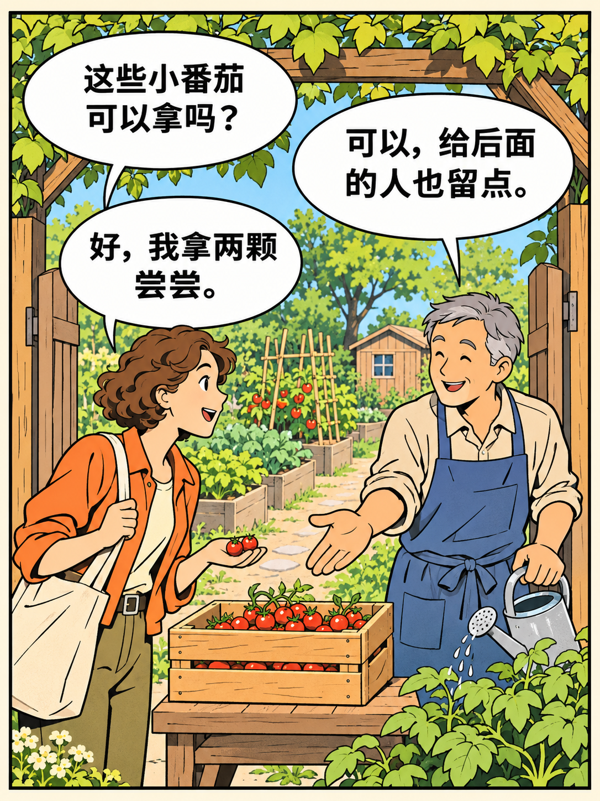

# 公众号剧情漫画 · wechat-comic

把文章或主题改编成适合手机阅读的中文漫画。默认采用法比清线，输出 3:4 竖幅页面，支持单场景对话和单页多格。[查看六种内置画风](references/styles.md)

## 成图示例 · 门口的小番茄

这一页用三句气泡推进情节。访客先问，园丁提醒，访客只拿两颗。气泡的阅读顺序为左上、右上、左下，木箱和手上的两颗番茄让读者看见她的选择。人物、场景和对白均为虚构。[查看对应的单页分镜 JSON](references/example-page.json)

## 用法

将整个 `wechat-comic` 文件夹放进 Codex 的技能目录，在对话中调用 `$wechat-comic`，并提供主题或文稿。

> 使用 $wechat-comic，把“社区花园的共享规则”画成 3 页清线漫画，加入简短的气泡对白。

生成成品图片需要当前环境提供生图工具。预览脚本使用 Python 标准库读取分镜和已有漫画页，生成离线 HTML。[查看分镜格式和预览命令](references/storyboard.md)

清线画风参考宝玉项目。[清线画风定义](https://github.com/JimLiu/baoyu-skills/blob/main/skills/baoyu-comic/references/art-styles/ligne-claire.md)
